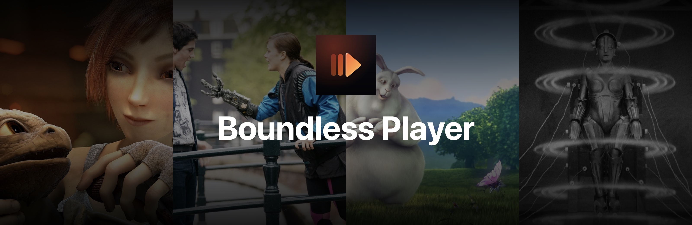
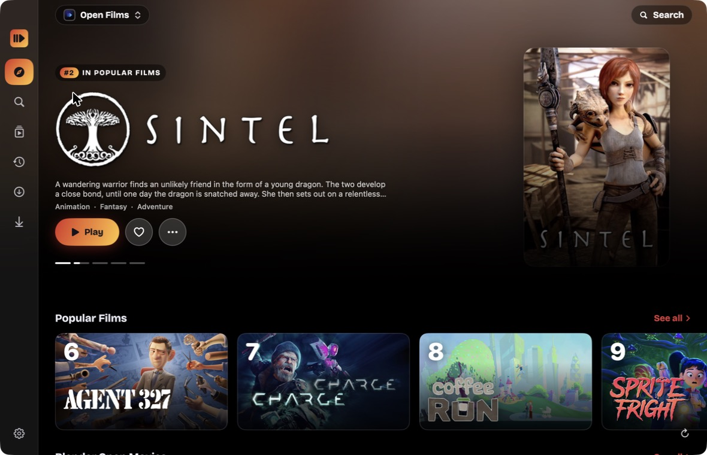
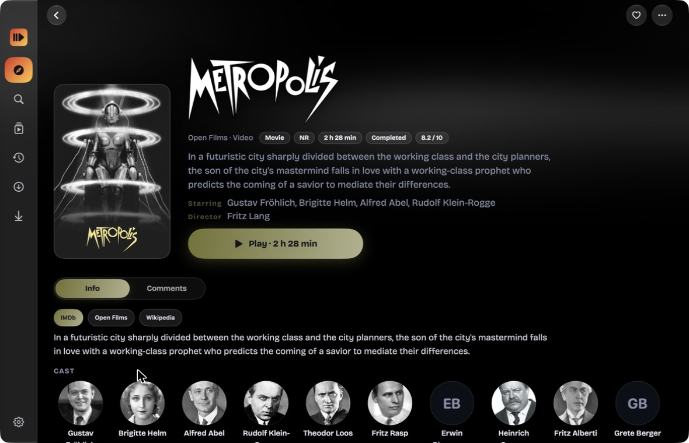
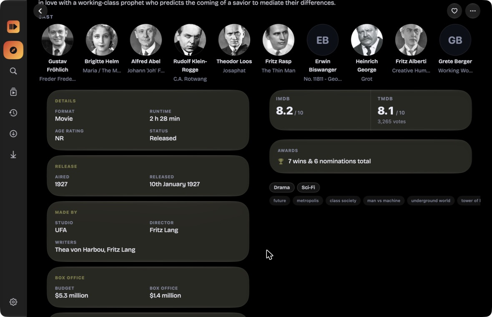

<div align="center">



# Boundless Player

**Movies, series and anime, one player.**

On iPhone, iPad, Mac and Android.

<p>
  <a href="https://github.com/BoundlessReader/BoundlessPlayer/releases/latest"></a>
  &nbsp;
  <a href="https://github.com/BoundlessReader/BoundlessPlayer/releases/latest"></a>
  &nbsp;
  <a href="https://github.com/BoundlessReader/BoundlessPlayer/releases/latest"></a>
</p>

[](https://github.com/BoundlessReader/BoundlessPlayer/releases/latest)
[](https://github.com/BoundlessReader/BoundlessPlayer/releases)
[](https://discord.gg/BDbk4AYV72)
[](https://boundless.moe)

[Download](#download) · [What's in it](#whats-in-it) · [Report a bug](https://github.com/BoundlessReader/BoundlessPlayer/issues/new?template=bug_report.yml) · [Request a feature](https://github.com/BoundlessReader/BoundlessPlayer/issues/new?template=feature_request.yml)

</div>

<br>

Boundless Player plays what you point it at: the sources you add and your own video files. Every title gets a page of its own, with the logo, the cast, photos and what the databases know about it.

<p align="center">
  
  
</p>
<p align="center">
  
</p>

<sub>Shown with the built-in Open Films source: Blender open movies (CC BY) and public domain classics. Art and data from TMDB.</sub>


## Download

| Platform | Get it |
| --- | --- |
| **Mac** | The DMG from [the latest release](https://github.com/BoundlessReader/BoundlessPlayer/releases/latest). It is signed and notarized by Apple, needs a Mac with Apple silicon (M1 or newer) and macOS 14 or later, and updates itself |
| **Android** | The APK from [the latest release](https://github.com/BoundlessReader/BoundlessPlayer/releases/latest). `arm64` suits most phones, `universal` works on any |
| **Windows** | The `-windows-x64-setup.exe` from [the latest release](https://github.com/BoundlessReader/BoundlessPlayer/releases/latest). It needs Windows 11 (64 bit) and installs for your user, with no administrator rights. It is not code signed yet, so Windows SmartScreen may warn the first time: choose More info, then Run anyway. The `.msi` next to it is the same installer for IT and the command line |
| **iPhone and iPad** | Through TestFlight and the App Store once Apple has processed 1.0.0 |

Updating from an earlier version keeps your library, progress and settings.

### Mac, from Terminal

```bash
bash <(curl -fsSL "https://raw.githubusercontent.com/BoundlessReader/BoundlessPlayer/main/install.sh")
```

This installs or updates Boundless Player in /Applications and checks the download against the checksum GitHub publishes for it. Add `--demo` to preview the installer without installing anything. The script is [install.sh](install.sh), so you can read it first.

## What's in it

- **A real player.** AirPlay, picture in picture, playback speed, audio and subtitle choices, servers and quality, an episode panel and Watch Together. HLS, MP4 and MKV play.
- **Subtitles done right.** SRT, VTT and ASS, with timing offsets a source can send and the track you chose kept as you chose it.
- **Title pages.** The title's own logo and backdrop, a silent clip behind the header on the Mac, cast with photos, stills you can open large, and more like this.
- **What the databases say.** Scores, awards, budget, box office and release dates from IMDb, TMDB, TVmaze, Wikidata, Wikipedia and AniList, in panels, with a synopsis you can switch between sources.
- **Browse.** A hero, feeds, genres, landscape cards with logos, ranked rails and a hover card on the Mac.
- **Yours.** A library with categories and filters, history, an updates feed, upcoming releases, statistics, and downloads for offline watching.
- **Your own files.** Import video and watch it with the same player.
- **Tracking.** Log what you watch on AniList, MyAnimeList, Kitsu, MangaUpdates, MangaBaka, Shikimori or Bangumi.
- **Everywhere.** Your library and place follow you through your account, iCloud and Google Drive backup.
- **Privacy and control.** App Lock, parental controls, Source Safety and a content rating you can set for each source.
- **Widgets and streaks.** Continue watching in one tap, and a streak with reminders.

## Help and feedback

- **Something broken?** [Open a bug report](https://github.com/BoundlessReader/BoundlessPlayer/issues/new?template=bug_report.yml). The error log in Settings helps a lot.
- **Have an idea?** [Suggest a feature](https://github.com/BoundlessReader/BoundlessPlayer/issues/new?template=feature_request.yml).
- **Questions and chat:** [Discussions](https://github.com/BoundlessReader/BoundlessPlayer/discussions) or [Discord](https://discord.gg/BDbk4AYV72).
- **Anything private:** support@boundless.moe.

Please search existing issues first, and add a thumbs up to the one that matches yours rather than opening a new one.

## About this repository

This repository hosts release builds, release notes and issue tracking. The source code is not public.

Security issues should be reported privately, see [SECURITY.md](SECURITY.md).

Data on title pages comes from IMDb through Cinemeta, TMDB, TVmaze, Wikidata, Wikipedia and AniList. This product uses the TMDB API but is not endorsed or certified by TMDB.

<div align="center">
<sub><a href="https://boundless.moe/privacy">Privacy</a> · <a href="https://boundless.moe/terms">Terms</a> · © Boundless. All rights reserved.</sub>
</div>
